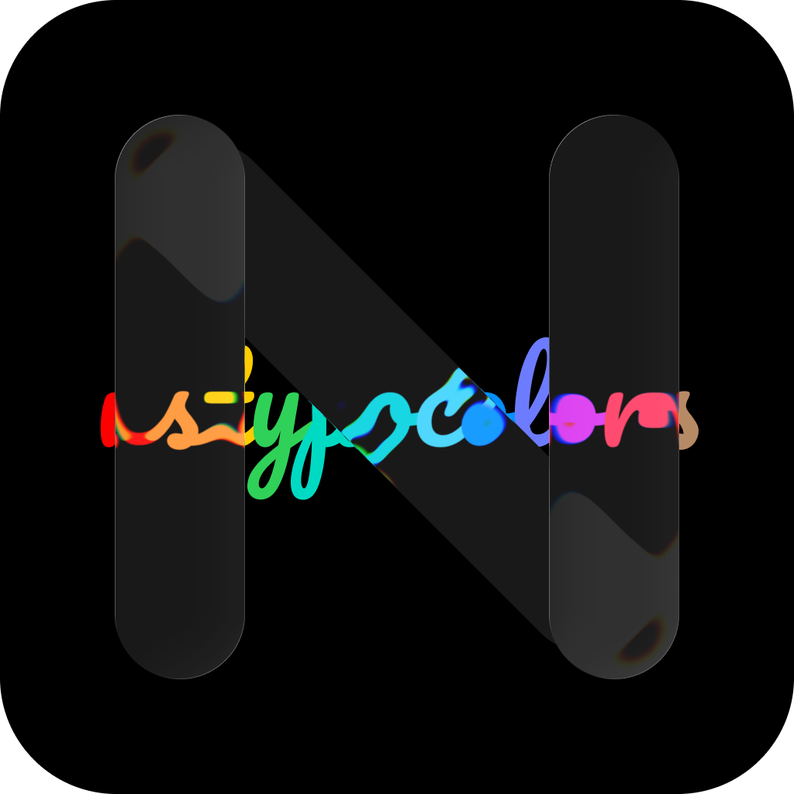
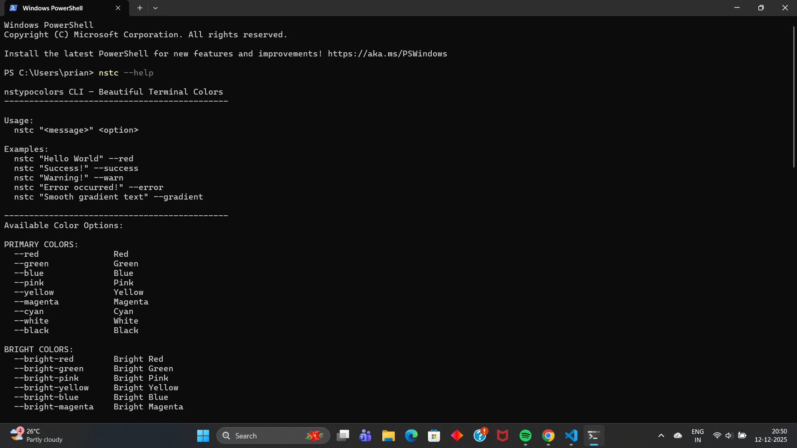
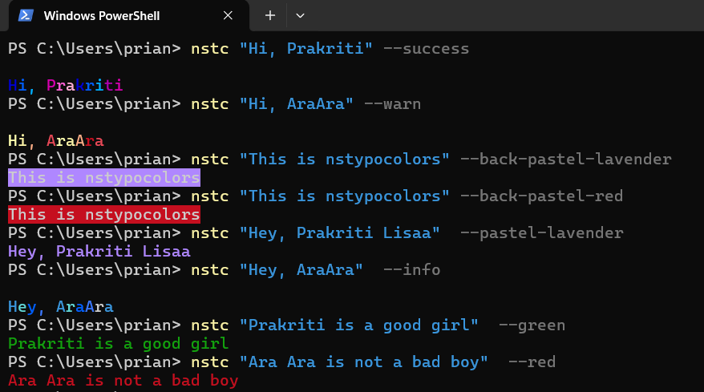

<div align="center">

# nstypocolors



[](https://www.npmjs.com/package/nstypocolors)

[](https://discord.gg/7SAcEv7MDd)
[](https://github.com/nsgpriyanshu/creatorsworld/graphs/contributors)
[](https://github.com/nsgpriyanshu/nstypocolors)
[](https://github.com/nsgpriyanshu/nstypocolors/actions/workflows/codeql.yml)


</div>

Minimal color and gradient logging utilities for modern TypeScript projects.

---

## Features

- Comprehensive color support: standard, bright, pastel, and background colors
- Special gradient effects including rainbow and success animations
- Integrated CLI tool (`nstc`) for direct terminal usage
- Help documentation and command reference
- Persistent default color configuration
- Full TypeScript support with strong type safety

---

## Installation

```bash
npm install nstypocolors
```

---

## Usage

### TypeScript/JavaScript

```ts
import { logRed, logGreen, logBlue, logSuccess } from 'nstypocolors'

logRed('This is red')
logGreen('This is green')
logBlue('This is blue')
logSuccess('Success message with gradient effect')
```

---

## CLI Reference

The package includes a command-line interface accessible via `nstc`.

### Basic Syntax

```bash
nstc "Your message" --color-flag
```

### Available Options

| Flag         | Description                |
| ------------ | -------------------------- |
| `--red`      | Red text                   |
| `--green`    | Green text                 |
| `--blue`     | Blue text                  |
| `--gradient` | Rainbow gradient effect    |
| `--success`  | Success gradient (default) |
| `help`       | Display help documentation |

---

## Help Documentation

View all available commands and options:

```bash
nstc help
```

---

## Example Usage

### Help Menu



### Terminal Output



---

> [!NOTE]
> **Coming Soon — Default Color Configuration**
>
> Set a persistent default color to avoid repeatedly passing color flags in every command.
>
> ### Planned Usage
>
> ```bash
> nstc set-default --green
> ```
>
> ### Reset Default
>
> ```bash
> nstc clear-default
> ```
>
> The default configuration will be stored locally in your home directory as a JSON file and applied automatically when no color flag is provided.
>
> _This feature is under development and will be available in an upcoming release._

## Available Colors

**Standard:** Red, Green, Pink, Yellow, Blue, Magenta, Cyan, White, Black

**Bright:** Bright Red, Bright Green, Bright Yellow, Bright Blue, Bright Magenta, Bright Cyan, Bright White

**Pastel:** Pastel Blue, Pastel Pink, Pastel Mint, Pastel Lavender, Pastel Coral, Pastel Yellow, Pastel Red, Pastel Green, Pastel Cyan, Pastel White

**Background:** Back Pastel Blue, Back Pastel Pink, Back Pastel Red, Back Pastel Green, Back Pastel Yellow, Back Pastel Mint, Back Pastel Coral, Back Pastel Lavender

---

## Gradient Effects

```ts
logGradient('Rainbow gradient text')
logSuccess('Success gradient text')
```

---

## Community Support

For assistance or contributions, connect with the community:

**Discord:** [https://discord.gg/vRXgWaar2G](https://discord.gg/vRXgWaar2G)

---

## Developer

<!--
 -->

[](https://nsgpriyanshu.github.io)
